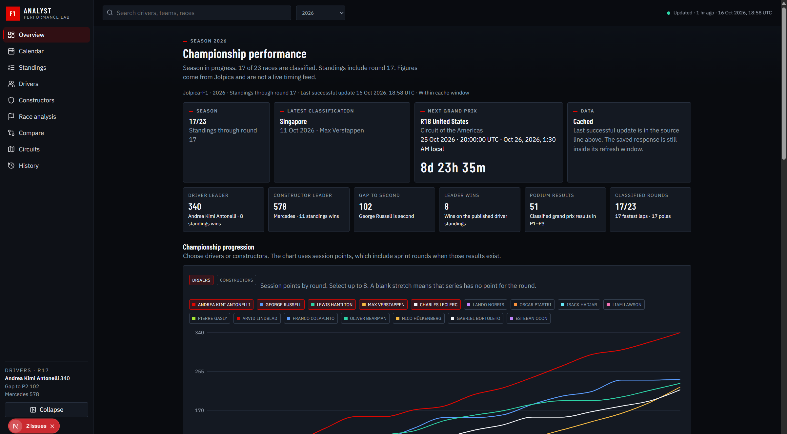
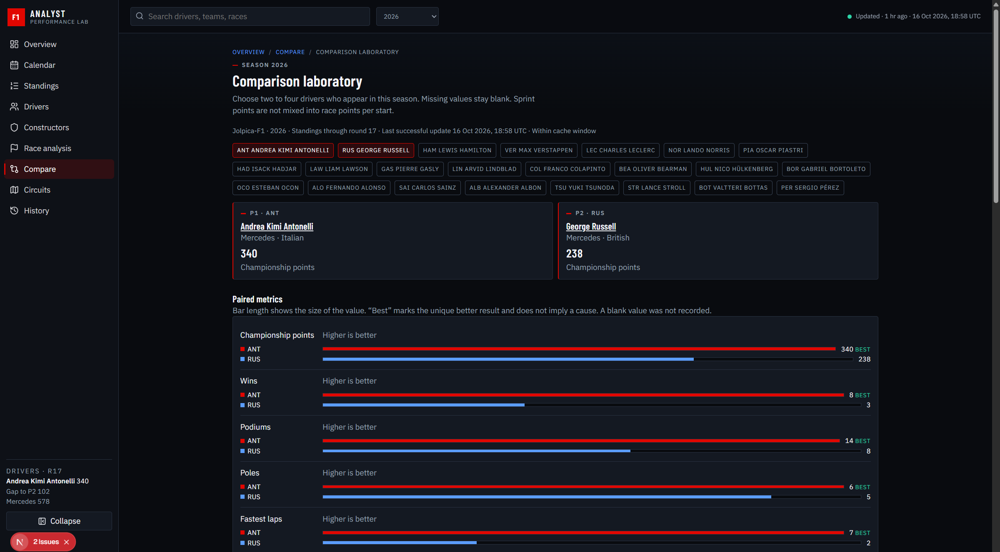
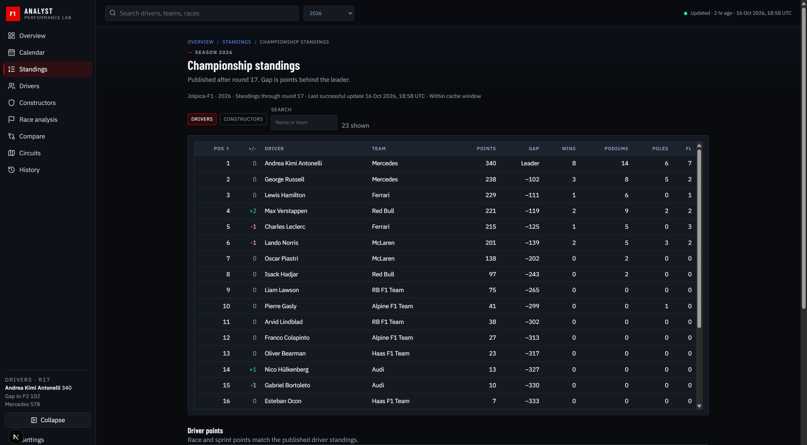
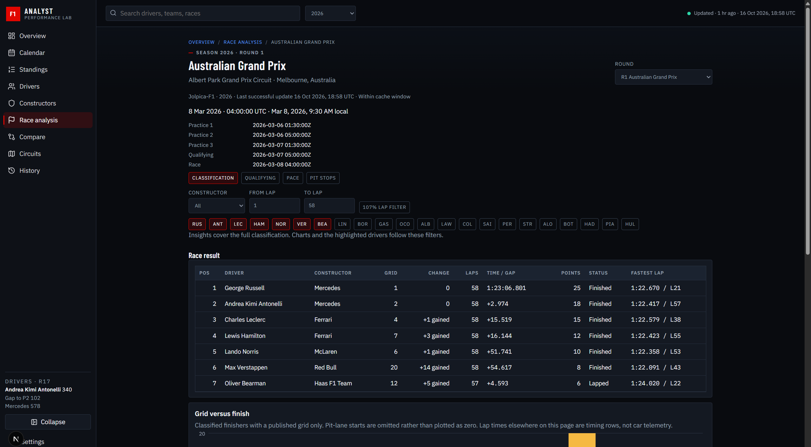
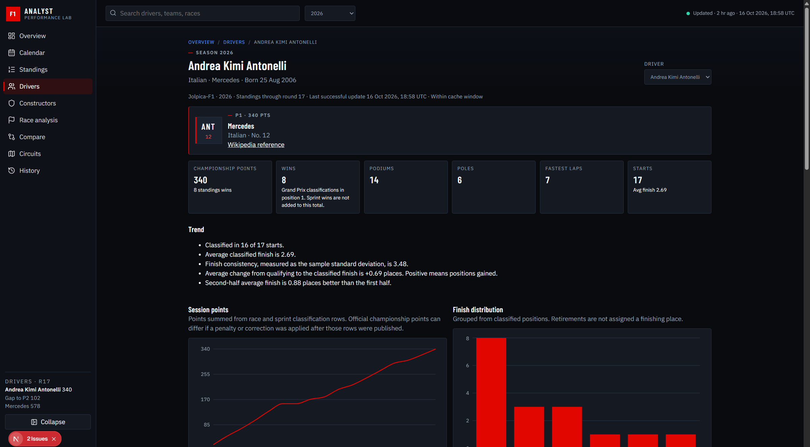
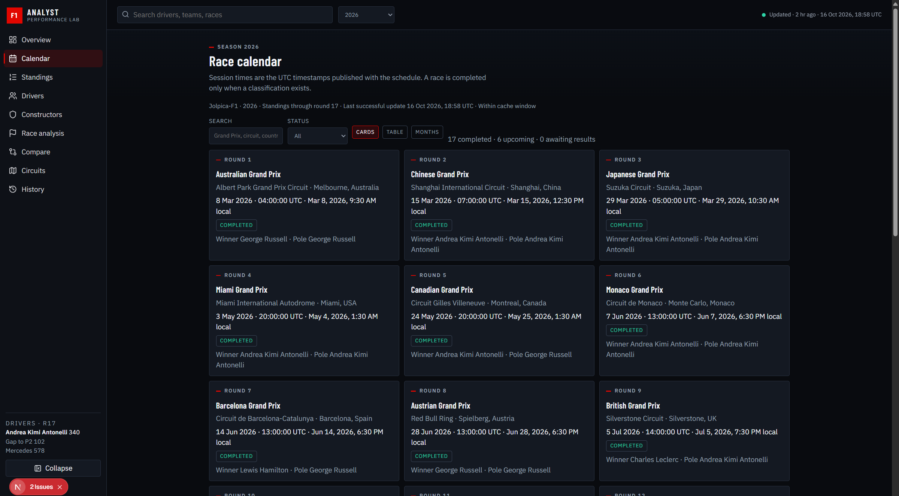
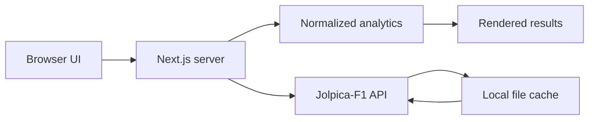

# F1 Analyst

F1 Analyst is a Formula 1 championship and race analytics application. It presents Jolpica-F1 data in a Performance Lab interface: a dark, data-first workspace for standings, progression, driver comparison, and race classification.

It is a reading and analysis tool. It is not a live timing feed, and it is not affiliated with Formula 1, the FIA, or the teams. Every figure is computed from a Jolpica response or omitted. There is no demo dataset.

## Screenshots

These images are captures of the running application.













## Key features

- Championship progression for selected drivers or constructors, plus official standings, points gaps, wins, and podiums.
- Driver and constructor profiles: season form, race-by-race results, qualifying versus finish, teammate or driver contribution, and championship position by season.
- Comparison laboratory for two to four drivers, including head-to-head qualifying and race finishes. Race points per start exclude sprint points.
- Race analysis for a selected round: classification, grid versus finish, qualifying, lap times, and pit-stop durations when Jolpica publishes them.
- Circuit explorer with location, recorded winners, and a map marker from the published coordinates.
- Historical standings, with an in-progress season kept out of champion rankings.
- Responsive Performance Lab shell: collapsible sidebar, season selector, search, and mobile navigation.
- Server-side Jolpica-F1 client with a local file cache, freshness and stale-data indicators, and explicit empty states when a metric is unavailable.

## Technology stack and architecture

- Next.js 15 App Router and React 19
- TypeScript
- Recharts for charts
- Lucide for icons
- Vitest for analytics tests
- IBM Plex Sans, IBM Plex Mono, and Barlow Condensed



The browser does not call Jolpica. App Router pages call the season service, which requests `https://api.jolpi.ca/ergast/f1`, stores the raw JSON in `data/cache`, and builds view models from the normalized rows. Charts, filters, and the shell are client components.

Requests are spaced about 260 milliseconds apart, time out after 20 seconds, and retry up to three times on HTTP 429, 5xx, and timeouts. Current standings expire after 30 minutes. Past seasons are kept for seven days. If a refresh fails and a saved response exists, the page shows that response and marks it stale.

## Data sources and limitations

The connected source is [Jolpica-F1](https://github.com/jolpica/jolpica-f1), an Ergast-compatible API:

`https://api.jolpi.ca/ergast/f1`

It supplies schedules, standings, race and sprint results, qualifying, lap times, pit stops, and circuits. No API key is required. Jolpica's unauthenticated allowance is about 4 requests per second and 500 requests per hour.

The app does not provide live timing, tyre compounds, sector times, or car telemetry. Sprint qualifying classifications are not loaded. Career charts use at most the 16 most recent seasons Jolpica lists for that driver or constructor. The history page loads at most 30 seasons at a time. A longer record is labelled as a window, not a complete career.

The cache is stored on local disk in `data/cache`. Hosting needs a writable cache directory and outbound HTTPS to `api.jolpi.ca`. Each server keeps its own cache unless `F1_CACHE_DIR` points at shared storage.

Other rules that keep the figures honest:

- A winner is shown only from a classified position 1. A past start without a classification is awaiting results.
- Wins are Grand Prix wins. Sprint wins are separate. Poles are qualifying position 1.
- Official standings points are kept separate from the sum of race and sprint rows. A mismatch is shown rather than overwritten.
- A Jolpica status of `Lapped` is classified when its position text is the finishing place, and stays unclassified when that text is a letter such as `R`.
- Track length, corner count, lap record, and race distance are omitted because they are not in the circuit feed.

## Installation and execution

Node.js 20 or newer and npm 10 or newer.

```bash
npm ci
npm run dev
```

Open [http://localhost:3000](http://localhost:3000). The first view of the current season can take several seconds. Later views reuse the cache.

Production:

```bash
npm run build
npm start
```

`npm start` serves the production build at [http://localhost:3000](http://localhost:3000). Set `PORT` if the host assigns another port. This is a Node server application. A static export will not work, because pages read Jolpica on the server.

Checks:

```bash
npm test
npm run typecheck
npm run lint
```

`npm test` runs Vitest. `npm run typecheck` runs `tsc --noEmit`. `npm run lint` runs `next lint`.

### Environment variables

Copy `.env.example` to `.env.local` only if you need to change a default. `.env.local` is gitignored. The example file contains public defaults, not secrets.

| Variable | Default | Purpose |
| --- | --- | --- |
| `JOLPICA_BASE_URL` | `https://api.jolpi.ca/ergast/f1` | API origin, without a trailing resource path |
| `F1_USER_AGENT` | `F1Analyst/1.0.0` | User agent sent to Jolpica |
| `F1_CACHE_DIR` | `data/cache` | Cache directory. It must stay inside the project |

## Project quality

The analytics tests cover classification, sprint points kept out of race points per start, head-to-head records, standings progression, in-progress seasons, and the rule that a missing classification is not turned into a winner.

Release check run for this version: 19 tests passed, `npm run typecheck` passed, `npm run lint` reported no ESLint warnings or errors, and `npm run build` compiled successfully. Next.js 15 prints a notice that `next lint` will be removed in Next.js 16. That notice is not a lint failure.
